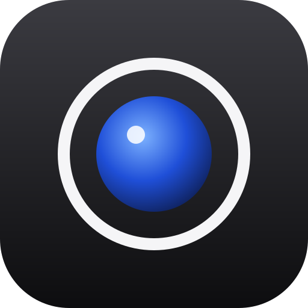
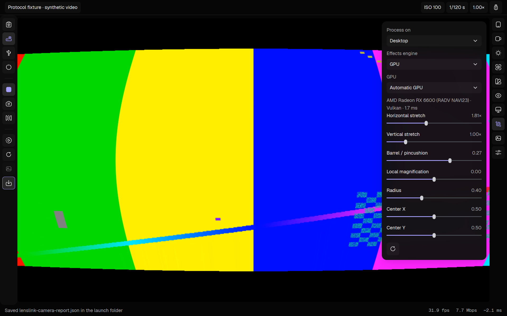

# OpenCam

**Turn your Android phone into a pro webcam. Free, open source, no accounts, no cloud.**

Phone-grade sensor, full manual camera controls, GPU effects, and a virtual camera for OBS, Zoom, Meet and the browser. Over USB, Wi-Fi, or **mobile data via Tailscale**.

[**Download**](https://github.com/DerpcatMusic/OpenCam/releases) · [Quick start](#quick-start) · [Features](#features) · [Docs](docs/technical.md)

## Why OpenCam

Your phone camera is better than any webcam. Existing apps lock the good parts behind subscriptions, watermarks or closed source. OpenCam doesn't.

- **Scan and go.** The PC shows a QR code, the phone scans it, you press Accept. No typing IPs.
- **Works anywhere.** USB, same Wi-Fi, or over mobile data through [Tailscale](https://tailscale.com). No relay server, no VPS.
- **Real camera controls.** ISO, shutter, focus, zoom, white balance, lens switching, torch, stabilization, straight from Camera2.
- **Fun image controls.** Hue, saturation, contrast, sharpen, stretch/lens distortion and person-aware background blur, on the phone GPU or the PC GPU.
- **Follows your phone.** Rotate the phone and the picture rotates with it.
- **Secure by design.** Pinned TLS certificate, per-session token, optional PBKDF2 password. Nothing leaves your network.
- **Fast.** Hardware H.264/HEVC with low-latency encoder hints, bounded queues that drop frames instead of piling up lag, automatic reconnect.
- **Open.** MIT licensed. Rust desktop app, native Java Android app.

## Quick start

1. **Phone:** install the APK from [Releases](https://github.com/DerpcatMusic/OpenCam/releases) and grant camera permission.
2. **PC:** download the package for your OS from Releases and run it. On Linux: `python3 install-desktop.py --desktop`.
3. **Pair:** in the desktop **Connection** panel press **Pair with QR code**, then on the phone choose **Connection → Scan code from computer**, and press **Accept** on the PC.
4. **Use it:** pick **OpenCam** as the camera in OBS, Zoom, Meet or your browser (needs a virtual-camera driver, see below).

Prefer cables? Enable USB debugging and press **USB**. Prefer no pairing? Phones on the same Wi-Fi are discovered automatically.

### Mobile data with Tailscale

Install [Tailscale](https://tailscale.com) on both devices and sign in to the same tailnet. Pair with the QR code as above; the phone advertises its Tailscale address automatically. End-to-end encrypted, no port forwarding, no cloud relay of ours.

### Virtual camera

| OS | What to install |
| --- | --- |
| Linux | `v4l2loopback` and `ffmpeg`, then `sudo modprobe v4l2loopback card_label=OpenCam exclusive_caps=1` |
| Windows | [Unity Capture](https://github.com/schellingb/UnityCapture) |
| macOS 13+ | OBS 30+ with its Camera Extension activated |

## Features

| | |
| --- | --- |
| **Camera** | Every lens Android exposes, resolution and FPS you can type or search, any advertised frame rate (not capped at 30) |
| **Exposure** | Auto/manual ISO and shutter, exposure compensation and lock, shutter-angle presets |
| **Focus and color** | Continuous AF or manual diopters, zoom, white balance presets and gains, hue, saturation, contrast, sharpen |
| **Effects** | Stretch, lens distortion, rotate/mirror, aspect fit/crop, person-segmentation background blur, on phone or PC GPU (Vulkan, DirectX 12, Metal) |
| **Quick tab** | Torch, processing and the controls you reach for most, one tap away on the phone |
| **Transport** | Hardware H.264/HEVC, or uncompressed YUV420/RGBA; built-in benchmark picks the best for your link |
| **Photo** | RAW DNG capture, transferred and checksum-verified |
| **Reliability** | Auto-reconnect, last-phone memory, watchdogs, frame dropping over buffering |

## How it compares

| | OpenCam | Iriun | Camo |
| --- | :---: | :---: | :---: |
| Open source | yes | no | no |
| Free, no watermark | yes | tiers | tiers |
| Linux desktop app | yes | yes | no |
| Mobile data (Tailscale) | yes | no | no |
| QR pairing | yes | yes | yes |
| Audio | not yet | yes | yes |
| iPhone | not yet | yes | yes |

Based on public documentation and our own [analysis](docs/competitors.md). We have **not** benchmarked latency against either product yet; help welcome, see the [benchmark plan](docs/competitors.md#what-must-be-measured-or-built-before-superiority-claims).

## Status and roadmap

Early but working: built and used on Linux with a real phone; Windows and macOS packages build in CI but need more hands-on testing.

- [ ] Audio streaming
- [ ] Background streaming (foreground service)
- [ ] iPhone companion
- [ ] Desktop hardware decode and zero-copy output
- [ ] Bundled, signed virtual-camera drivers
- [ ] Recording, LUTs, scenes

## Contributing

Issues, device reports and PRs are very welcome. Phone model plus a camera report (`opencam-camera-report.json`) makes bugs much easier to fix. Build instructions and the full technical reference live in [docs/technical.md](docs/technical.md).

If OpenCam is useful to you, a ⭐ helps others find it.

  

## License

MIT. Third-party components keep their own licenses, see [docs/technical.md](docs/technical.md#zeron-toolkit-and-source-reuse).
